<p align="center">
  
</p>

# Design System Glass

**Vidrio, color y claridad para interfaces que se sienten vivas.** Un sistema de diseño front-end escalable: tokens semánticos, superficies de vidrio, componentes accesibles y documentación pensada para que personas y agentes construyan sin inventar.

`v2.0` · WCAG 2.2 AA · Tailwind CSS 3.4 · Next.js · AI-ready

> El átomo de la portada está animado con CSS dentro del SVG. Si el sistema operativo pide menos movimiento, las órbitas quedan quietas.

---

## Qué es

Design System Glass es la capa de diseño que va antes del producto. Define **cómo se ve, cómo se comporta y cómo se documenta** una interfaz: un fondo de color, superficies translúcidas, una tipografía con jerarquía y un puñado de componentes con reglas explícitas.

No es una librería de pantallas cerradas. Es un contrato reutilizable:

- **Tokens** en `tokens.json`, la única fuente de verdad.
- **CSS** generado a partir de esos tokens (`tokens.css`, `tailwind/globals.css`).
- **Componentes** con clases `dsg-*`, vista previa y guía de uso.
- **Marca** con logo, portada y reglas de movimiento.
- **Capa para agentes**: `AGENTS.md`, `llms.txt`, `components/registry.json` y un validador sin dependencias.

## Principios

1. **Claridad antes que efecto.** El vidrio organiza la información; nunca baja el contraste. Todo texto pasa 4.5:1 en ambos temas.
2. **Transparencia también en el contenido.** Una fecha estimada se ve distinta de una confirmada; un indicador demostrativo se marca como tal. El sistema comunica intención, no certezas inventadas.
3. **Un color, un significado.** `accent` = acción y «en desarrollo»; `accent-warm` = piloto y pendientes; `success` = liberado y confirmado; `danger` = bloqueo. El color siempre va con texto o ícono.
4. **Dos superficies, un sistema.** La superficie pública y la administrativa comparten componentes; la administrativa se distingue por el tono `admin` y un fondo con más violeta.

## Empieza en 60 segundos

### 1. Instala el preset y los estilos

Copia `tailwind/dsg-preset.js` y `tailwind/globals.css` a tu proyecto de Next.js + Tailwind 3.4:

```js
// tailwind.config.js
module.exports = {
  presets: [require('./tailwind/dsg-preset')],
  content: ['./src/**/*.{ts,tsx}'],
};
```

```css
/* app/globals.css */
@import './tailwind/globals.css';
```

Carga las fuentes con `next/font/google` y asígnalas a `--dsg-font-display`, `--dsg-font-sans` y `--dsg-font-mono`. La guía completa está en [INSTALACION.md](INSTALACION.md).

### 2. Activa el tema y el fondo

```html
<html lang="es" data-theme="dark">
  <body class="dsg-mesh font-sans text-ink">
    <article class="dsg-glass p-6">
      <p class="font-mono text-eyebrow uppercase text-accent">Catálogo</p>
      <h1 class="font-display text-display-lg text-ink">Proyectos</h1>
      <span class="dsg-chip dsg-chip--accent">En desarrollo</span>
    </article>
  </body>
</html>
```

Sin `data-theme`, el sistema sigue `prefers-color-scheme`. El tema oscuro es el predeterminado del producto.

### 3. Revisa la galería

Abre [`index.html`](index.html) en el navegador. Es la documentación visual: tokens, vidrio, tipografía, componentes y guía, con interruptor de tema. No necesita red: las fuentes y Tailwind Play están vendorizados. También puedes servirla:

```bash
npm run serve
# http://localhost:4173
```

## Explora

| Documento | Qué encontrarás |
| --- | --- |
| [`docs/01-discovery.md`](docs/01-discovery.md) | Auditoría del repo: inventario, hallazgos, riesgos y decisiones. |
| [`docs/02-architecture.md`](docs/02-architecture.md) | Capas, flujo de tokens, theming y cómo extender el sistema. |
| [`docs/03-tokens.md`](docs/03-tokens.md) | Referencia completa de color, tipografía, espacio, radios y sombras. |
| [`docs/04-components.md`](docs/04-components.md) | Catálogo, reglas de composición, accesibilidad y patrones. |
| [`docs/05-brand.md`](docs/05-brand.md) | Marca, logo animado, voz y uso correcto de los assets. |
| [`docs/06-ai-experience.md`](docs/06-ai-experience.md) | Cómo trabajan los agentes con este repo. |
| [`docs/07-contributing.md`](docs/07-contributing.md) | Añadir componentes, tokens y releases. |
| [`docs/08-migration.md`](docs/08-migration.md) | Migración del namespace anterior a `dsg-*`. |
| [`docs/09-audit.md`](docs/09-audit.md) | Evidencia de accesibilidad, contraste y regresión visual. |
| [`components/registry.json`](components/registry.json) | Registro legible por máquina de cada componente. |
| [`AGENTS.md`](AGENTS.md) | Contrato operativo para agentes. |
| [`llms.txt`](llms.txt) | Índice compacto para modelos y asistentes. |

## Estructura

```text
.
├── index.html                  # Galería navegable (documentación visual)
├── tokens.json                 # Fuente de verdad de los tokens
├── tokens.css                  # Generado desde tokens.json
├── INSTALACION.md              # Instalación en Next.js + Tailwind
├── README.md                   # Este documento
├── CONTRIBUTING.md             # Flujo para contribuir
├── CODE_OF_CONDUCT.md          # Convivencia en la comunidad
├── SECURITY.md                 # Reporte de vulnerabilidades
├── TRADEMARKS.md               # Uso de la marca y los logos
├── LICENSE                     # MIT
├── AGENTS.md                   # Contrato para agentes
├── CLAUDE.md                   # Puntero a AGENTS.md
├── llms.txt                    # Índice para modelos
├── assets/brand/               # Banner, logo, marca y favicon (SVG)
├── assets/fonts/               # WOFF2 locales, OFL y fonts.css
├── components/
│   ├── bundle.css              # Clases .dsg-*
│   ├── registry.json           # Catálogo legible por máquina
│   ├── registry.schema.json
│   └── <Componente>/
│       ├── README.md           # Reglas y accesibilidad
│       └── preview.html        # Vista previa aislada
├── docs/                       # Documentación extensa
├── schema/tokens.schema.json   # Esquema de tokens.json
├── scripts/
│   ├── build.mjs               # Genera tokens.css, globals.css y play-config.js
│   └── validate.mjs            # Valida integridad, contraste, a11y y registro
├── tailwind/
│   ├── dsg-preset.js           # Preset de Tailwind 3.4
│   ├── globals.css             # Generado: tokens + componentes
│   ├── play-config.js          # Generado: config para Tailwind Play CDN
│   └── vendor/                 # Tailwind Play 3.4.17 vendorizado (MIT)
```

## Temas y tokens

El tema se fija con `data-theme` en `<html>`:

| Atributo | Resultado |
| --- | --- |
| `data-theme="dark"` | Modo oscuro, predeterminado. |
| `data-theme="light"` | Modo claro. |
| sin atributo | Sigue `prefers-color-scheme`. |

Los tokens se nombran por **significado**, no por valor: `canvas`, `ink`, `glass`, `line`, `accent`, `success`, `danger`, `admin`. En CSS se exponen como `--dsg-*`; en Tailwind, como `bg-canvas`, `text-ink`, `border-glass-rim`, etc.

```css
/* Correcto: el tema cambia solo */
background: var(--dsg-glass);
color: var(--dsg-ink);

/* Incorrecto: fija un valor y rompe el modo claro */
background: rgba(255, 255, 255, 0.055);
```

La referencia completa, con valores por tema y reglas de contraste, está en [`docs/03-tokens.md`](docs/03-tokens.md).

## Componentes

| Componente | Para qué | Clases principales |
| --- | --- | --- |
| [Glass](components/Glass/README.md) | Superficie base de cards, paneles y menú. | `.dsg-glass`, `.dsg-glass--panel`, `.dsg-inset` |
| [Button](components/Button/README.md) | Acciones primarias, secundarias y de decisión. | `.dsg-btn--primary`, `--secondary`, `--danger` |
| [SegmentedControl](components/SegmentedControl/README.md) | 2–4 opciones excluyentes. | `.dsg-seg`, `.dsg-seg__btn` |
| [NavItem](components/NavItem/README.md) | Navegación lateral con estado activo. | `.dsg-nav-item`, `.dsg-nav-count` |
| [StatusChip](components/StatusChip/README.md) | Estado con texto y color. | `.dsg-chip--accent`, `--success`, `--danger` |
| [DateBadge](components/DateBadge/README.md) | Fecha confirmada vs. estimada. | `.dsg-date--confirmed`, `--estimated` |
| [Notice](components/Notice/README.md) | Avisos por severidad. | `.dsg-notice--danger`, `--warning` |
| [Scorecard](components/Scorecard/README.md) | Indicador con valor y contexto. | `.dsg-kpi`, `.dsg-kpi__value` |
| [ProgressBar](components/ProgressBar/README.md) | Avance calculado por hitos. | `.dsg-progress`, `.dsg-progress__bar` |
| [NewsTicker](components/NewsTicker/README.md) | Cinta de actualizaciones pausable. | `.dsg-ticker`, `.dsg-ticker__track` |
| [Field](components/Field/README.md) | Entradas con etiqueta visible. | `.dsg-field`, `.dsg-input` |
| [Diff](components/Diff/README.md) | Cambios publicados vs. propuestos. | `.dsg-del`, `.dsg-ins` |
| [Cover](components/Cover/README.md) | Portada de marca con átomo. | Tokens de marca |

Cada componente tiene una vista previa aislada en `components/<Nombre>/preview.html` y una entrada en [`components/registry.json`](components/registry.json).

## Para agentes

Este repo está diseñado para que un agente pueda trabajar sin adivinar. El orden de lectura recomendado es:

1. [`AGENTS.md`](AGENTS.md): reglas no negociables, mapa del repo y definición de terminado.
2. [`llms.txt`](llms.txt): índice corto con lo esencial.
3. [`components/registry.json`](components/registry.json): qué componente usar, cuándo evitarlo y qué clases existen.
4. [`docs/06-ai-experience.md`](docs/06-ai-experience.md): flujo de trabajo, recetas y guardrails.

Reglas que un agente no debe romper:

- No inventar tokens, colores ni variantes que no estén en `tokens.json` o `bundle.css`.
- No anidar `.dsg-glass` dentro de `.dsg-glass`; usar `.dsg-inset`.
- No usar el color como única señal de estado.
- No crear un componente sin `README.md`, `preview.html` y entrada en el registro.
- Ejecutar `npm run validate` antes de dar una tarea por terminada.

## Calidad

```bash
npm run build      # regenera tokens.css, tailwind/globals.css y play-config.js
npm run validate   # comprueba artefactos, tokens, contraste, a11y, enlaces y previews
npm run check      # alias de validate
```

El validador no tiene dependencias y corre en Node 20+. También se ejecuta en CI con [`.github/workflows/validate.yml`](.github/workflows/validate.yml).

## Estado

| Área | Estado |
| --- | --- |
| Tokens y temas | Estable |
| Componentes base (13) | Estable |
| Galería y documentación | Estable |
| Capa para agentes | Estable |
| Librería publicada en npm | Preparada, sin publicar |
| Licencia | MIT |
| Navegadores | Chrome/Edge 111+, Firefox 113+, Safari 16.4+ |
| Modo offline | Galería y previews sin red |
| Accesibilidad | Contraste y estructura automatizados; lector de pantalla pendiente |
| Regresión visual | Revisión manual dark/light y 500px |
| Cambios | [`CHANGELOG.md`](CHANGELOG.md) |

## Contribuir

Lee [`CONTRIBUTING.md`](CONTRIBUTING.md) para el flujo rápido y [`docs/07-contributing.md`](docs/07-contributing.md) para el contrato completo.

- [`CODE_OF_CONDUCT.md`](CODE_OF_CONDUCT.md): convivencia y reporte de conducta.
- [`SECURITY.md`](SECURITY.md): reporte privado de vulnerabilidades.
- [`TRADEMARKS.md`](TRADEMARKS.md): uso del nombre, el logo y los assets de marca.

## Licencia

MIT · Copyright (c) 2026 Daniel Aceves. Puedes usar, copiar, modificar, fusionar, publicar, distribuir, sublicenciar y vender copias del software, siempre que conserves el aviso de copyright y esta licencia. Consulta [`LICENSE`](LICENSE).

Las fuentes Bricolage Grotesque, IBM Plex Sans e IBM Plex Mono se usan bajo SIL Open Font License; Tailwind Play se distribuye bajo MIT. Sus avisos son independientes y deben conservarse al redistribuir esos archivos. Las marcas y los logos se rigen por [`TRADEMARKS.md`](TRADEMARKS.md).

---

<p align="center"><sub>Design System Glass · construido para verse bien, leerse mejor y escalar sin ruido.</sub></p>
